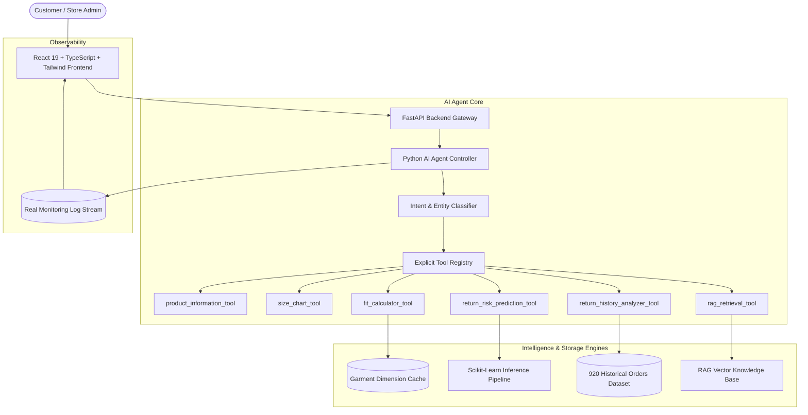

# Return or Regret AI — System Architecture

## 1. Architectural Philosophy
**Return or Regret AI** is an intelligent shopping decision agent built around the core maxim:
> **"Fix the product page, not the customer."**

Rather than penalizing customers for sizing uncertainty or bracketing orders, the system targets pre-purchase information asymmetry. It prevents avoidable returns by matching customer body measurements against actual garment dimensions, running trained machine learning risk models, and diagnosing product-level specification defects.

---

## 2. Component Details

### A. Frontend Layer (Single Page Application)
- **Framework:** React 19 + TypeScript + Vite.
- **Styling & Design System:** Tailwind CSS with custom palette (slate navy `#0f172a`, warm background `#f8fafc`, coral-orange accent `#f97316`).
- **Icons & Data Visualization:** Lucide React icons (no emojis) and Recharts (responsive area charts, bar charts, donut distributions).
- **Page Modules:**
  1. `/dashboard`: Executive return rate telemetry and KPI summaries.
  2. `/assistant`: Flagship multi-tool conversational assistant with live tool execution accordion and source citations.
  3. `/products`: Interactive catalog with detailed size chart modal and fit diagnostics.
  4. `/risk-analysis`: Interactive pre-purchase ML risk calculator with parameter simulation.
  5. `/insights`: Root-cause product defect detection and AI suggestion approval queue.
  6. `/monitoring`: Real inference latency telemetry, confusion matrices, and model comparison benchmarks.

### B. Backend Layer (REST API & Agent Orchestrator)
- **Framework:** FastAPI with asynchronous ASGI execution (Uvicorn).
- **Validation:** Pydantic models for request bodies and response contracts.
- **CORS:** Configured for local development (`localhost:5173`) and multi-origin access.

### C. Registered Tool Architecture
The agent relies on 6 deterministic, isolated Python tools:
1. `product_information_tool`: Extracts verified fabric composition, care instructions, and known fit quirks.
2. `size_chart_tool`: Returns exact garment dimensions (inches) across all published sizes.
3. `fit_calculator_tool`: Computes body-to-garment ease differentials ($\Delta = \text{Garment} - \text{Body}$), comparing against fit tolerances (Slim Fit, Regular Fit, Relaxed Fit).
4. `return_risk_prediction_tool`: Pre-purchase feature inference using the trained Scikit-Learn pipeline.
5. `return_history_analyzer_tool`: Aggregates historical return percentages and defect reason clusters.
6. `rag_retrieval_tool`: High-speed vector retrieval across policy, fabric stability, and sizing documents.

