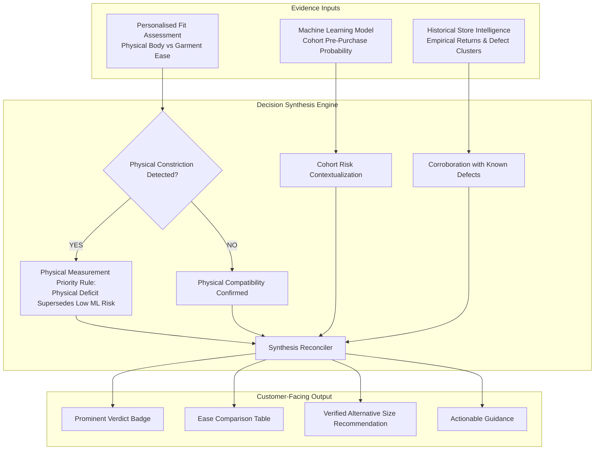

# Decision Synthesis Engine — Multi-Evidence Reconciliation

## 1. The Multi-Evidence Dilemma in E-Commerce AI

In retail decision intelligence, three distinct layers of evidence provide signals regarding product purchase and return risk:

1. **Layer 1: Personalised Physical Fit Assessment**
   - Ground Truth: Direct mathematical comparison between customer anatomical measurements and authentic garment dimensions.
   - Metric: Calculated Ease ($\text{Ease} = \text{Garment Dimension} - \text{Customer Body Dimension}$).
   - Characteristic: Highly individual, deterministic, and immediate.

2. **Layer 2: Machine Learning Cohort Return Prediction**
   - Ground Truth: Probabilistic estimate derived from historical order patterns across pre-purchase product attributes (category, price, fit type, discount, bracketing).
   - Metric: $P(\text{Returned} = 1 \mid X)$.
   - Characteristic: Cohort-level statistical probability. It evaluates broad catalog trends, not individual anatomical compatibility.

3. **Layer 3: Historical Store Intelligence**
   - Ground Truth: Empirical return rates, defect clustering, and verified customer feedback for the specific product style.
   - Metric: Historical return rate % and percentage breakdown of primary return reasons (e.g. 50% returns cite shoulder tightness).
   - Characteristic: Empirically observed post-purchase realities.

---

## 2. Evidence Reconciliation Rules

### Rule 1: The Physical Priority Invariance Principle
> **A low ML population return probability can NEVER override an active physical body measurement deficit.**

*Example:* A customer with a 40" bare chest considering Size M of `P001` (40.0" garment chest) has exactly 0.0" ease. A Slim Fit Oxford shirt requires a minimum of +1.5" ease for normal respiratory and shoulder mobility.  
Even though the ML model estimates an overall 11.8% return rate for this style (due to favorable category baseline and normal pricing), the garment will physically choke and button-gap.  
**Decision Synthesis Action:** The verdict is classified as **High Fit Concern**. The explanation explicitly clarifies:
> *"While the Machine Learning model estimates a relatively low general return probability (11.8% based on pre-purchase category and price features), physical garment measurements take precedence. A low cohort return probability cannot overcome an individual ease deficit."*

### Rule 2: Corroboration with Historical Defect Clusters
When a physical measurement reveals tension (e.g., shoulder width deficit of 0.5"), the Decision Synthesis Engine inspects the historical return reasons for that product.  
If the primary return reason is *"Shoulder / Armhole Tightness"* (accounting for 50% of historical returns on P001), the engine highlights this direct link:
> *"Empirical store records confirm this pattern: 50.0% of past returns for Heritage Oxford Slim Shirt cited 'Shoulder / Armhole Tightness', directly matching the tightness identified in your assessment."*

### Rule 3: Verified Alternative Size Inspection
Before advising the customer to "size up", the engine inspects the catalog's size chart for Size L:
- If Size L measurements exist in `size_chart` (e.g. Chest 43.0", Shoulder 18.5"), the engine verifies that Size L provides +3.0" chest ease and +0.5" shoulder ease.
- It recommends Size L with verified dimensional evidence.
- If Size L is not in the chart, it explicitly notes that alternative size measurements cannot be verified from the catalog.

---

## 3. Mathematical Basis: No Arbitrary Blending
Rather than inventing an uncalibrated "Combined Risk Index" (e.g. $0.5 \cdot \text{Fit} + 0.3 \cdot \text{ML} + 0.2 \cdot \text{Hist}$), the system employs a **Lexicographic Evidence Hierarchy**:
1. **Physical Compatibility Gate:** If $\text{Ease} < \text{MinEase}(\text{FitType})$, verdict $\in \{\text{Fit Concern}, \text{High Fit Concern}\}$.
2. **Defect Corroboration:** Increases diagnostic confidence when defect reasons match the tight anatomical zone.
3. **Cohort Contextualization:** Used to advise on promotional/bracketing behavior (e.g. warning against ordering multiple sizes simultaneously when a single verified size matches).

